# Comparative Bioinformatics Analysis of Insulin Protein Sequences Across Selected Mammalian Species

Abdul Wali Khan University Mardan | Department of Biotechnology | 2026

**Authors:** Zeeshan Shah

## Overview
Comparison of insulin protein sequences from 10 mammals: amino acid composition, physicochemical properties, conserved/variable sites, evolutionary distances, and phylogeny.

## Sequences
| No. | Species | Common name | Accession |
|---|---|---|---|
| 1 | Homo sapiens | Human | AAA59172.1 |
| 2 | Pan troglodytes | Chimpanzee | CAA43403.1 |
| 3 | Macaca mulatta | Rhesus macaque | XP_028688882.1 |
| 4 | Mus musculus | Mouse | NP_032413.1 |
| 5 | Rattus norvegicus | Rat | CAA24560.1 |
| 6 | Bos taurus | Cow | NP_776351.2 |
| 7 | Sus scrofa | Pig | AAQ00990.1 |
| 8 | Equus caballus | Horse | NP_001421663.1 |
| 9 | Canis lupus familiaris | Dog | P01321.1 |
| 10 | Oryctolagus cuniculus | Rabbit | AAA19033.1 |

## Tools
NCBI Protein, ExPASy ProtParam, MEGA 11 (Poisson distances, NJ and ML trees, 1,000 bootstraps), R/RStudio, Microsoft Excel

## Key results
- Alignment: 110 positions, 68 conserved, 42 variable
- Pairwise distances: 0.0183 to 0.2472
- Aliphatic index vs GRAVY: r = 0.741, p = 0.014
- Molecular weight vs GRAVY: r = -0.315, p = 0.375 (not significant)

## Repository contents
- insulin_project_paper.pdf: full report
- insulin_sequences.fasta: 10 insulin sequences
- result_interpretation.xlsx: results workbook
- PNG files: all figures shown below

## Multiple Sequence Alignment
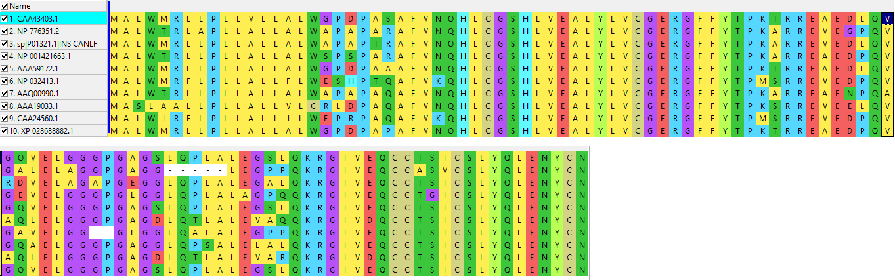

## Conserved and Variable Sites
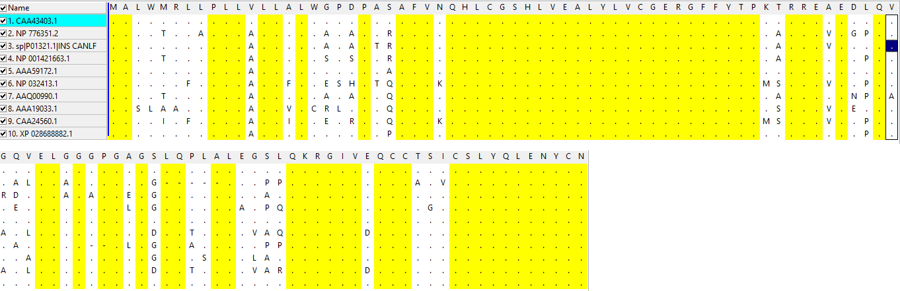

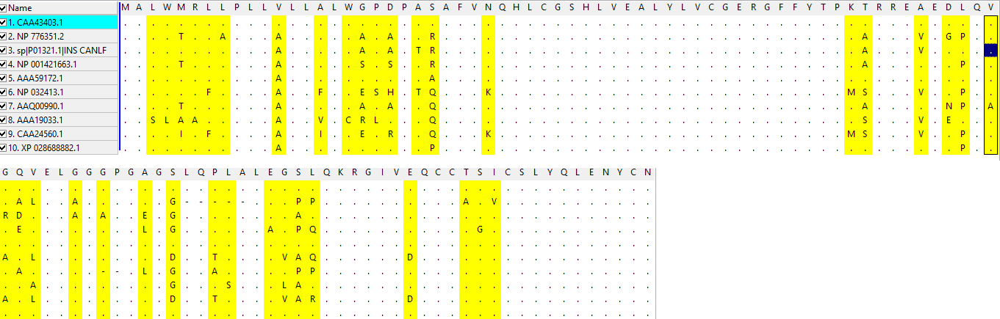

## Phylogenetic Trees
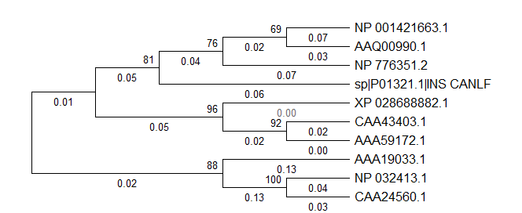

## Physicochemical Properties
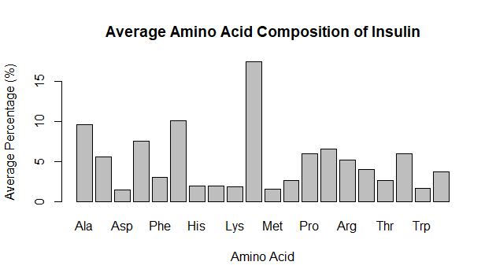

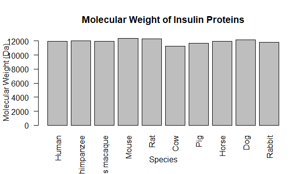

![Theoretical pI]theoretical_pI.png)

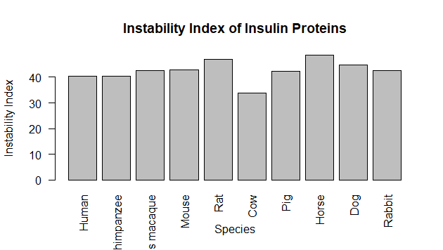

## Evolutionary Distances
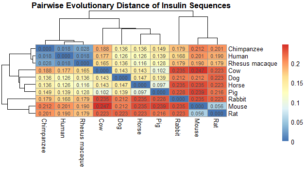

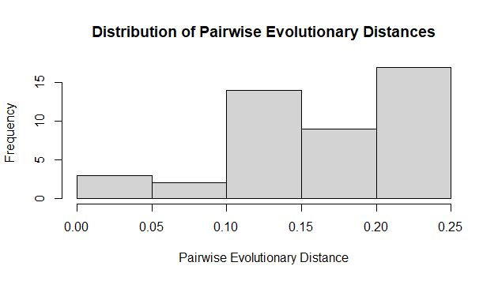

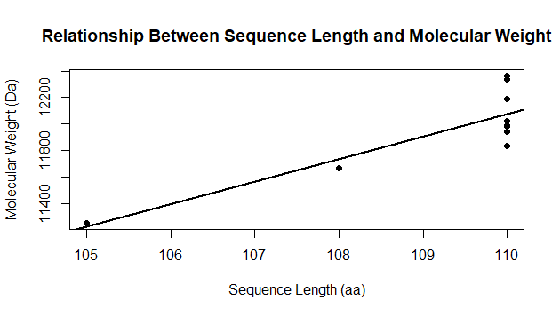

## Correlations
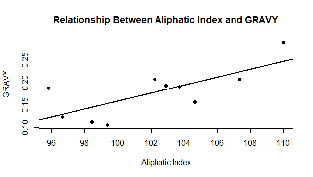

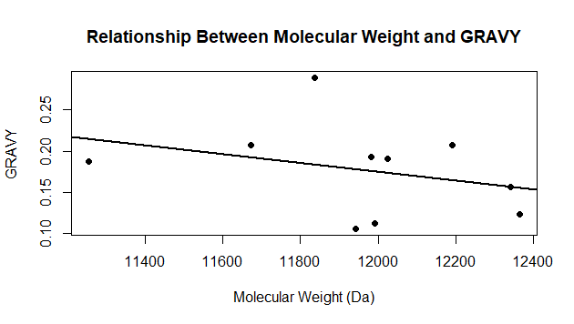

